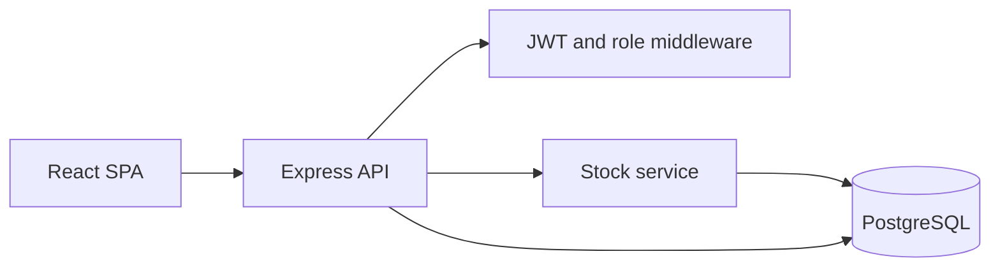
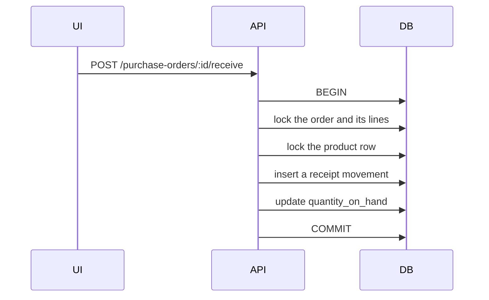

# StockSense

StockSense is a warehouse inventory app for a small operation. It tracks products and suppliers, raises purchase orders, and keeps an on-hand balance that only moves when someone records a receipt or an issue.

Staff, managers, and admins share one system. The API enforces what each role is allowed to do. The screens hide buttons a role cannot use, but that is only a convenience.

## Features

- Products, suppliers, purchase orders, and stock movements, each with its own screens and REST endpoints.
- Roles: admin, manager, and staff. `requireAuth` loads the user on every request, and `requireRoles` blocks writes the role is not allowed to make.
- Receipts and issues run in a Postgres transaction. The product row is locked, the movement is inserted, and `quantity_on_hand` is updated together. A `CHECK` constraint (`products_quantity_non_negative`) rejects a negative balance.
- A low-stock report lists active products whose on-hand quantity is at or under the reorder level, with the shortfall.
- List endpoints paginate on the server (`page`, `limit`, `total`). The same filters drive a CSV export.
- Jest and Supertest hit a real Postgres database. GitHub Actions starts that database and runs the suite.

## Roles

| Action | Admin | Manager | Staff |
| --- | --- | --- | --- |
| Users | create, deactivate | no | no |
| Products and suppliers | create, edit | create, edit | view |
| Purchase orders | create, submit, cancel, receive | same | view |
| Manual receipt | yes | yes | no |
| Issue stock | yes | yes | yes |
| Low-stock report and CSV export | yes | yes | yes |

An admin cannot deactivate their own account or change their own role.

## Architecture



A receipt from a purchase order stays in one transaction: lock the order, lock each product in a stable order, write the ledger row, and raise the balance. If any line would receive more than is still open, the whole receipt rolls back.



`quantity_on_hand` is a cached balance of the movement ledger. The product API refuses a direct edit of that column. Summing receipts and subtracting issues should match the stored balance; the seed checks that before it finishes, and the tests check it after stock changes.

## Folder structure

```
.
├── client/                 React UI (Vite)
│   ├── src/pages/          Products, suppliers, orders, movements, low stock, users
│   ├── src/components/     Layout, tables, modal
│   ├── Dockerfile
│   └── nginx.conf          Serves the build and proxies /api
├── server/
│   ├── src/routes/         REST routers
│   ├── src/stock.js        Receipt and issue transactions
│   ├── src/purchaseOrders.js
│   ├── src/reports.js      Low-stock SQL and the dashboard summary
│   ├── src/migrations/     Schema, including the quantity check
│   ├── src/models.js       Sequelize models
│   ├── tests/              Jest + Supertest against Postgres
│   └── Dockerfile
├── docker-compose.yml
├── .env.example
└── .github/workflows/ci.yml
```

## Running locally

You need Node 20+ and PostgreSQL 16.

```bash
sudo -u postgres psql -c "CREATE USER stocksense WITH PASSWORD 'stocksense' LOGIN;"
sudo -u postgres psql -c "CREATE DATABASE stocksense OWNER stocksense;"
sudo -u postgres psql -c "CREATE DATABASE stocksense_test OWNER stocksense;"
```

```bash
cp .env.example .env
```

Set `JWT_SECRET` in `.env` to a long random string. The server reads that file from the repo root.

```bash
cd server
npm ci
npm run migrate
npm run seed
npm run dev
```

The API listens on port 4000.

```bash
cd client
npm ci
npm run dev
```

Open http://localhost:5173. Vite proxies `/api` to the API.

Seeded accounts, all using the `SEED_PASSWORD` from `.env` (default `changeme`):

| Email | Role |
| --- | --- |
| admin@stocksense.local | admin |
| manager@stocksense.local | manager |
| staff@stocksense.local | staff |

The seed also loads a small catalog, opening balances, one issue, and a submitted purchase order for tape and labels. Running it again does nothing once a user exists.

## Docker

Docker Compose starts Postgres, the API, and an nginx image of the UI.

```bash
export JWT_SECRET="$(openssl rand -hex 24)"
docker compose up --build
```

The UI is at http://localhost:8080 and the API at http://localhost:4000. Compose seeds on boot. If `JWT_SECRET` is unset, Compose uses a local-only placeholder. Do not point that at a shared environment.

`SEED_PASSWORD` defaults to `changeme` in Compose as well.

## Tests

Create the `stocksense_test` database shown above, then:

```bash
cd server
npm run lint
npm test
```

Jest applies `server/tests/env.js`, which points at `stocksense_test` unless `DATABASE_URL` is already set. The suite migrates, truncates between tests, and covers roles, pagination, CSV escaping, the negative-stock check, a rolled-back receipt, and two issues racing on the same product.

```bash
cd client
npm run lint
npm run build
```

CI does the same against a Postgres 16 service container.

## Design decisions

**Ledger plus balance.** Every receipt and issue is a row in `stock_movements`. The product row keeps `quantity_on_hand` so lists do not have to sum the ledger. Both writes share a transaction, so a crash cannot leave one without the other.

**Lock, then check, then constraint.** The service takes `SELECT … FOR UPDATE` on the product before changing it, so overlapping issues queue on that row and the second one sees the updated balance. The app returns a clear insufficient-stock error before it writes. The `CHECK` constraint still rejects a negative balance if something updates the table directly.

**Purchase order numbers.** `purchase_order_number_seq` starts at 1001. Postgres does not return a used sequence value when a transaction aborts, so a failed create can leave a gap in the numbers. The number only has to be unique.

**Receiving.** A draft has to be submitted before it can be received. A receipt cannot exceed the quantity still open on a line (`quantity_received <= quantity_ordered` is also a check). Status becomes `partial` until every line is filled, then `received`. Cancelling is only allowed before any quantity has been received.

**Pagination.** Lists use `limit` and `offset`, capped at 100 rows a page. The response includes `total` and `totalPages`. Offset pagination gets slower on very deep pages; it is a reasonable fit for this catalog. CSV export uses the same filters, builds the file on the server, and refuses more than 10,000 rows (`EXPORT_MAX_ROWS`) so a wide-open export does not try to buffer the whole warehouse.

**Passwords and sessions.** Passwords are hashed with bcrypt. Login returns a JWT. The UI stores it in `localStorage` and sends `Authorization: Bearer`. Each request reloads the user, so deactivating someone cuts off a token that has not expired yet.

**Money.** Unit cost is `NUMERIC(12, 2)` and travels as a string so the client does not do binary floating point with it.

## Configuration

| Variable | Purpose |
| --- | --- |
| `DATABASE_URL` | Postgres connection string |
| `JWT_SECRET` | Signing key for login tokens |
| `JWT_EXPIRES_IN` | Token lifetime, default `8h` |
| `PORT` | API port, default `4000` |
| `CLIENT_ORIGIN` | CORS origin, comma-separated if you need more than one |
| `SEED_PASSWORD` | Password for the three demo accounts |
| `SEED_ON_BOOT` | Set to `true` to seed when the API starts |
| `BCRYPT_ROUNDS` | Cost factor, default 10. Tests use 4 |
| `EXPORT_MAX_ROWS` | CSV cap, default 10000 |
| `SQL_LOG` | Set to `1` to print SQL |
